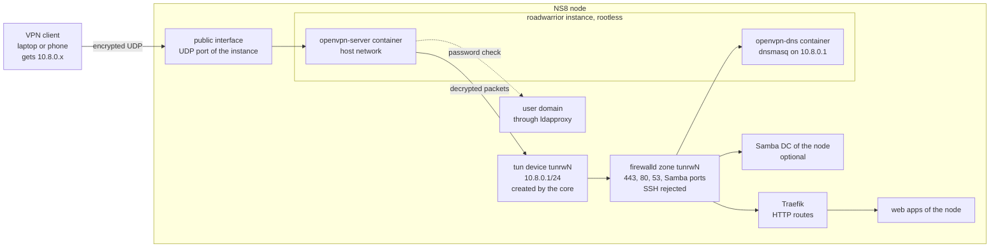
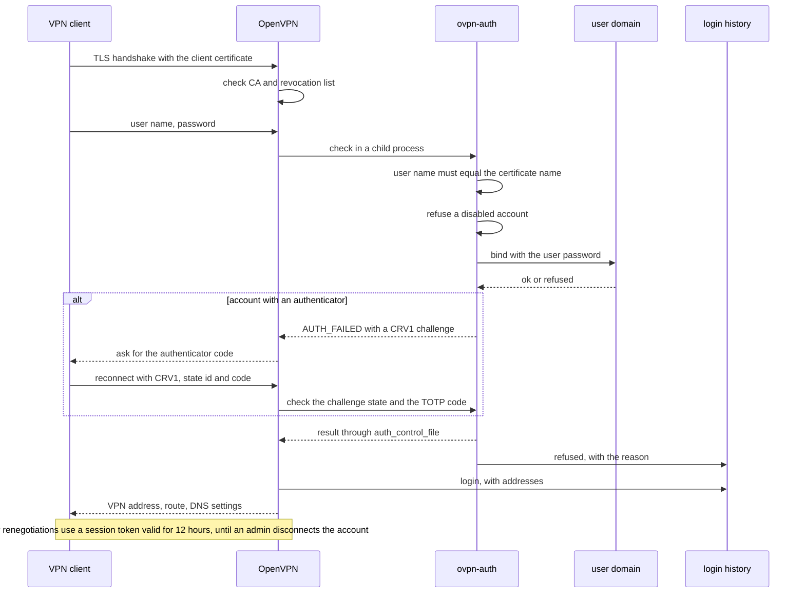
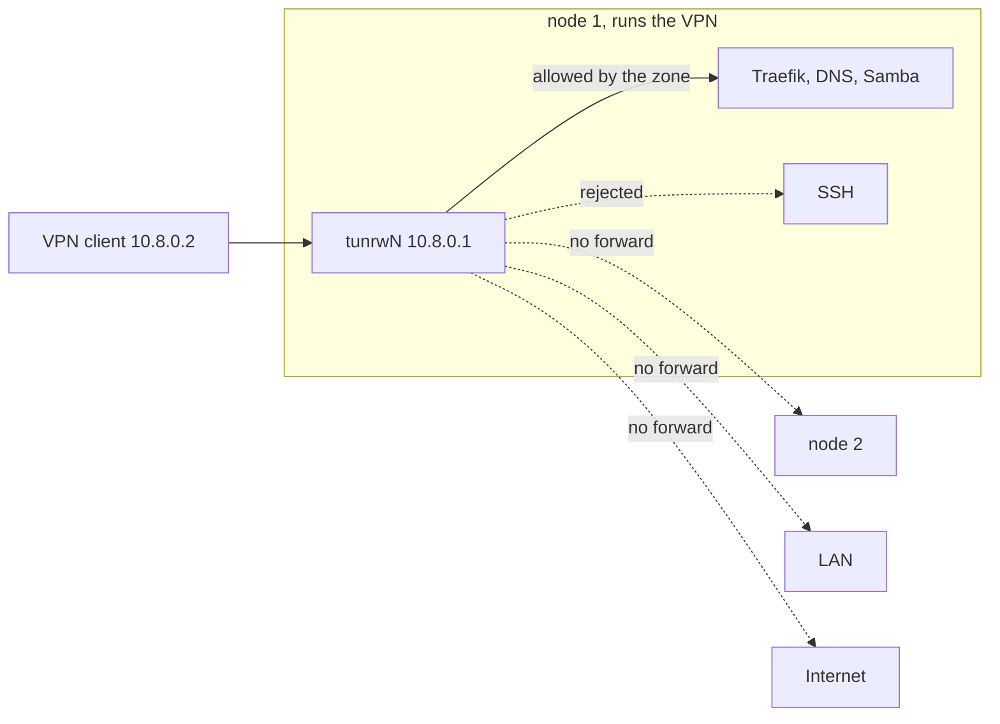
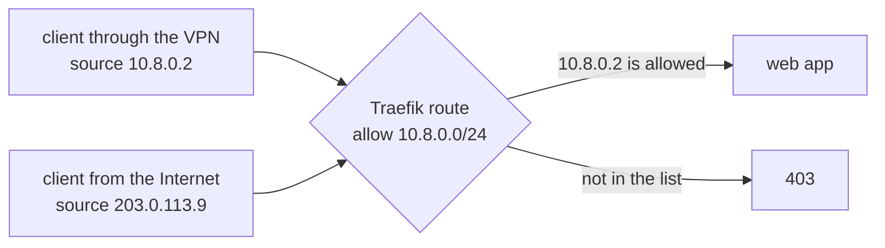
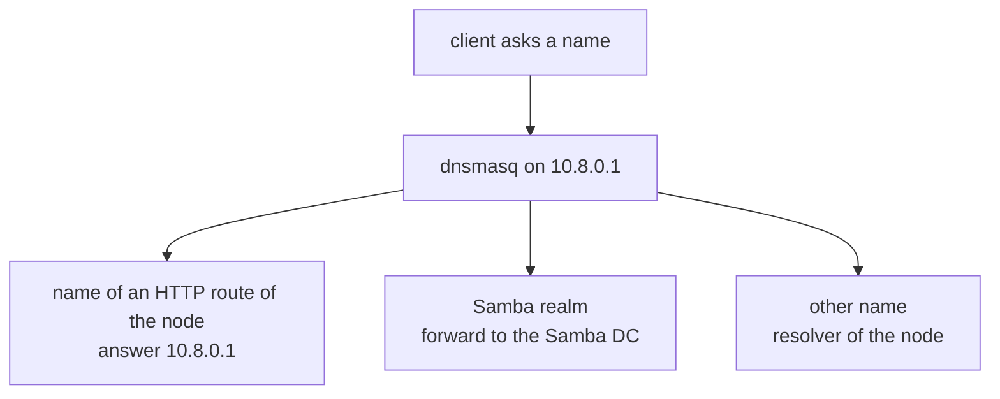
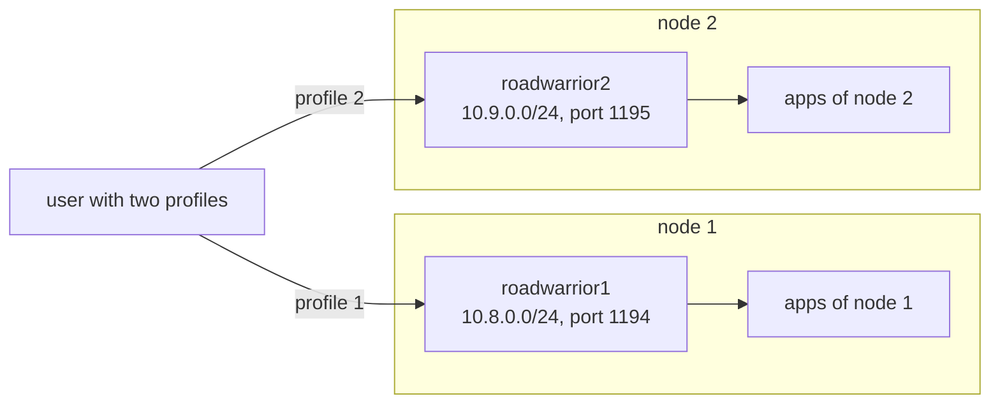
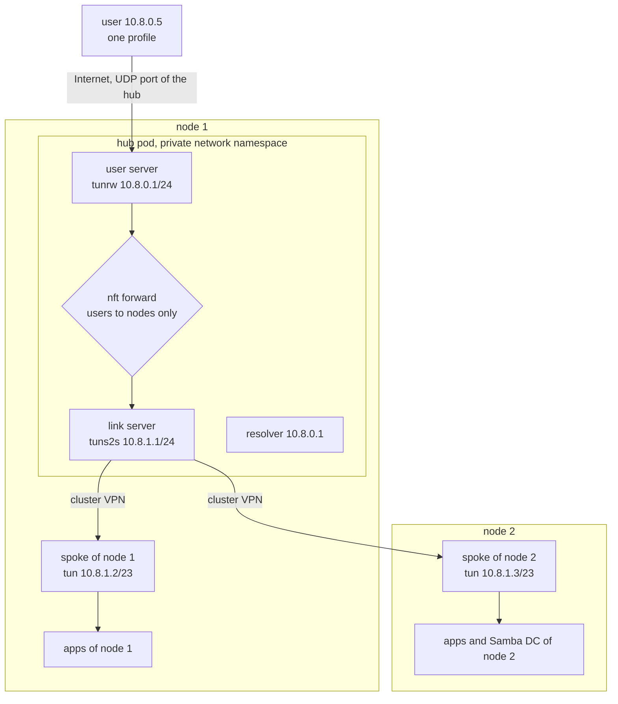
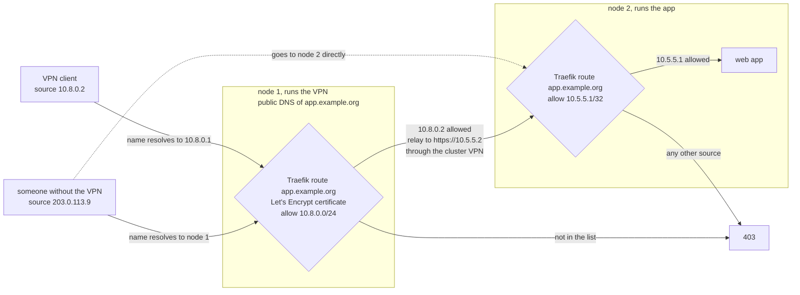

# How the network works

This page explains the path of a VPN client, from the Internet to the web apps of the node. It also explains why a client reaches only the node it connects to.

## The pieces



The module runs rootless, so it cannot create network devices or firewall rules. It asks the core instead:

- `add_tun` creates the tun device with the server address, for example `10.8.0.1/24`.
- `add_custom_zone` puts the tun in its own firewalld zone. That zone opens only the ports the clients need.
- `add_public_service` opens the UDP port of the instance on the public side.

OpenVPN runs with the host network and receives the tun from the core. It does not configure addresses or routes itself (`ifconfig-noexec`, `route-noexec`). Without a container network in the middle, throughput stays close to the line rate.

## A login



In certificate mode the password and code steps are skipped: the certificate alone gives access.

The challenge state lives 3 minutes and works once.

## Where the packets can go



The node does not forward packets from the tun zone. So a client reaches the services of this node only. The default route of the client stays on its own network: its Internet traffic does not enter the VPN.

Reaching the LAN or Internet through the VPN needs a firewalld policy with forward and masquerade. A rootless module cannot create it. Other nodes of the cluster are reached with [a hub](#a-hub-and-its-nodes), which forwards in its own network namespace.

## Keeping an app for the VPN clients

Traefik runs on the host network too, so it sees the real VPN address of the client, for example `10.8.0.2`. An HTTP route with "Allow access from" set to the VPN network then accepts the VPN clients only.



The client must reach the app through the VPN for this to work. That is the job of the DNS below.

## DNS



The names of the HTTP routes and the FQDN of the node resolve to the VPN address of the node. Their traffic enters the VPN and Traefik sees `10.8.0.x`. Without the VPN resolver, the same name gives the public address: the traffic goes around the tunnel and an app kept for the VPN answers 403.

The server pushes the resolver three ways, so each client finds one it knows:

- `dhcp-option DNS 10.8.0.1`, for every client;
- `dhcp-option DOMAIN <domain>`, so NetworkManager and Windows send those domains to the VPN resolver;
- `dns server 0 address` and `resolve-domains`, the split DNS of OpenVPN 2.6 clients;
- `dns search-domains`: an OpenVPN 2.7 client drops the `dhcp-option DOMAIN` lines when it gets `dns` options, and rebuilds them from this list for NetworkManager.

The domains are the parent domains of the route names and of the node FQDN, plus the Samba realm when the file server is open. When the VPN host shares one of these domains, the full host names are pushed instead of the domain.

The host of the VPN server is left out on purpose. A client that keeps the VPN resolver during a reconnect would otherwise look for the server inside the tunnel.

When an HTTP route is added or removed, the `hosts-changed` event rewrites the dnsmasq list.

## Windows clients in the domain

With `expose_samba` on, the VPN opens the ports of the domain controller, NTP included, and the realm resolves through the tunnel.

- A computer already joined to the domain opens the session with its cached credentials, then the user connects the VPN. Kerberos, the shares and the group policies work from there, the policies at their next refresh.
- A network logon before the session, for a new user or an expired password, needs the VPN up before Windows asks for the password. Only the `certificate` mode allows it, with the profile started by the OpenVPN service: the password and TOTP checks are lost.
- Joining a computer to the domain through the VPN is not tested.

## Use the VPN

The profile holds no DNS setting: the server pushes it at each connection. What the client does with it depends on the client.

- NetworkManager, OpenVPN Connect, OpenVPN GUI on Windows and Tunnelblick apply it on their own.
- The `openvpn` command on Linux does not change the resolver by itself. Run it with the systemd-resolved helper of your distribution, for example:

      openvpn --config alice@vpn.example.org.ovpn --script-security 2 \
        --up /etc/openvpn/update-systemd-resolved --down /etc/openvpn/update-systemd-resolved --down-pre

Check from the client, once connected, with `app.example.org` an HTTP route of the node:

1. The name gives the VPN address of the node.

       resolvectl query app.example.org      # Linux with systemd-resolved
       nslookup app.example.org              # Windows, macOS

   Expect `10.8.0.1`. A public address means the client does not use the VPN resolver.

2. The packets go through the tunnel.

       ip route get 10.8.0.1                 # Linux: dev tun0
       route print                           # Windows: 10.8.0.0 on the VPN adapter

3. Traefik sees the VPN address. Open the app: with "Allow access from" set to the VPN network it answers, without the VPN it answers 403.

If the name still gives the public address, flush the DNS cache of the client (`resolvectl flush-caches`, `ipconfig /flushdns`) and check that the browser does not use its own DNS over HTTPS.

## Several nodes

Each node that runs apps for the VPN clients needs its own instance, with its own network and port. A user gets one profile per node. For a web app, [a relay route](#a-web-app-of-another-node) avoids the second instance.



## A hub and its nodes

One instance is the hub: the users connect to it, with one profile. Each other node that serves apps runs an instance with the role "node of a hub", a spoke. The spoke has no users and no public port: it joins the hub through the cluster VPN. The users of the hub then reach the apps and the Samba DC of every spoke.



The core never forwards between two zones of a node. So the hub runs its two tunnels in a private network namespace, owned by the module, and forwards there with its own nft rules. The firewall of the node is not involved. The rules let a user open a connection to a node, and nothing else: users never reach each other, and a node never opens a connection to a user.

The hub does no NAT. Every node sees the real VPN address of the client, for example `10.8.0.5`, and an HTTP route of any node filters with "Allow access from" set to the VPN network. The spoke tun takes the prefix of both networks, here `/23`, so the replies go back into the tunnel with no extra route.

The hub also runs a spoke for its own node: from the private namespace, the apps of the node are reached like those of the others.

### Addresses

The link takes the network next to the VPN network, in the same supernet. With `10.8.0.0/24`:

| Address | Role |
|---|---|
| `10.8.0.1` | user server and resolver of the hub |
| `10.8.0.2` and up | users |
| `10.8.1.1` | link server of the hub |
| `10.8.1.2` | spoke of the hub node |
| `10.8.1.3` and up | spokes of the other nodes, in the order they join |

The validation of the hub refuses a VPN network whose supernet overlaps a node network or the cluster VPN.

### DNS

The resolver of the hub answers each app name with the address of the spoke of the node that serves it. When a spoke opens its Samba DC, the realm is forwarded to the DC, and the hub pushes a route to the DC address through that node.

### Joining

No instance has rights on another one. The admin, or the UI of the node, carries the request:

1. `request-spoke-certificate` on the node makes its key, once, and returns a certificate request. The key never leaves the node.
2. `add-spoke` on the hub signs it with the CA of the link, which is apart from the CA of the users, and returns the address of the node.
3. `configure-module` on the node takes that answer as `join`.

The node keeps the answer in its backup, so a restore or a new save needs no new join. A spoke follows its hub when it moves: it reads the cluster VPN address of the hub node at each start. A hub restored or cloned gets a new instance id: join the nodes again.

`remove-spoke` on the hub revokes the certificate of a node. The node keeps trying until its role changes.

### Throughput

A packet crosses three OpenVPN processes, the user server, the link server and the spoke, and two pasta translations. On test VMs a client reached about 300 Mbit/s to another node, over HTTP, HTTPS and SMB, against about 880 Mbit/s to a standalone instance. Kernel DCO would cut this cost, but a rootless module cannot add a DCO peer.

## A web app of another node

The VPN reaches only the node that runs it. A web app of another node can still be kept for the VPN clients: the Traefik of the VPN node relays it to the other node through the cluster VPN. Nothing changes in the core or in the firewall, it takes two HTTP routes.

In this example the VPN runs on node 1 with the network `10.8.0.0/24`, and the app `app.example.org` runs on node 2. The cluster VPN gives node 1 the address `10.5.5.1` and node 2 the address `10.5.5.2`.



The steps:

1. Point the public DNS name of the app to node 1. Node 1 then gets the Let's Encrypt certificate, and the client sees a valid certificate.
2. On node 1, add an HTTP route for the name of the app. Its URL is the cluster VPN address of node 2, with "Skip certificate validation", because node 1 connects to an address and not to the name. Restrict it to the VPN network of the instance.
3. On node 2, restrict the route of the app to the cluster VPN address of node 1. Without this restriction, anyone who reaches node 2 can ask for the app with the right name and go around the VPN.

The routes from the command line, on the leader:

```bash
redis-cli get cluster/network      # the cluster VPN network, here 10.5.5.0/24

api-cli run set-route --agent module/traefik1 --data '{
  "instance": "relay-app",
  "host": "app.example.org",
  "url": "https://10.5.5.2",
  "skip_cert_verify": true,
  "lets_encrypt": true,
  "http2https": true,
  "ip_allowlist": ["10.8.0.0/24"]
}'

api-cli run list-routes --agent module/traefik2    # find the route of the app, often its module id

api-cli run set-route --agent module/traefik2 --data '{
  "instance": "<route of the app>",
  "ip_allowlist": ["10.5.5.1/32"]
}'
```

`set-route` merges the request into the existing route, so the other settings of the app route stay as they are. The same settings exist in the HTTP routes page of the cluster admin.

The VPN DNS needs no change. The relay route is a route of node 1, so the dnsmasq of the instance answers its name with `10.8.0.1`, and the traffic enters the tunnel.

Things to know:

- Node 2 sees `10.5.5.1`, not the client. Its logs cannot tell which VPN client came in; the login history of the instance can.
- The allowlist of node 2 accepts everything that leaves node 1, not only the VPN clients.
- Only HTTP and HTTPS go through. IMAP, SMB or SSH of node 2 stay out of reach.
- An app that sets its own allowlist when it is configured again replaces this one. Check the allowlist of node 2 after a change in the app settings.
- The allowlist of node 1 does not stop Let's Encrypt: Traefik answers the TLS-ALPN challenge on port 443 before any HTTP route.
- If the public DNS name moves back to node 2, the certificate of node 1 cannot renew.

## Clone and move

A clone or a move copies the PKI, the accounts, the authenticator secrets and the history. The new instance creates its own tun, zone and port on the target node. The profiles keep the old host. They work again once the host name points to the new node, or after a new download if the host was an IP address. While the original instance still runs on the same node, the copy cannot take the same port and network, and it stays stopped until the original is removed.
