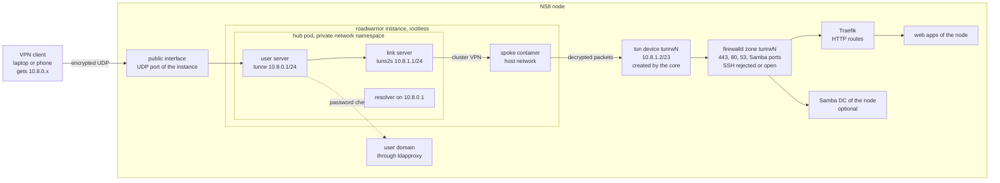
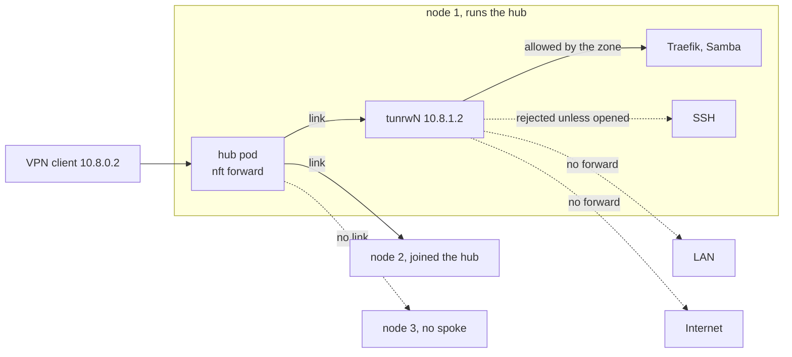
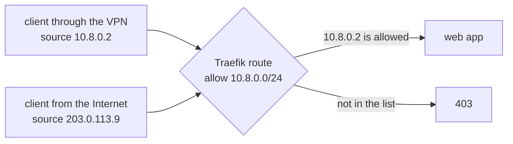
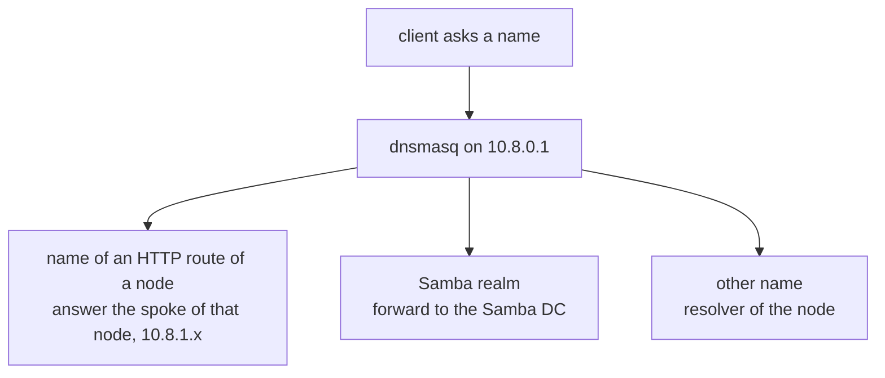
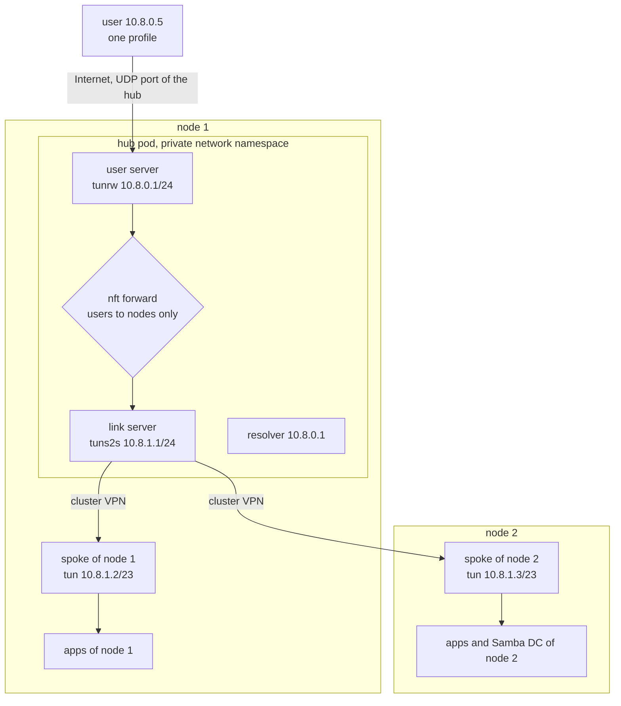

# How the network works

This page explains the path of a VPN client, from the Internet to the web apps of the node, and to the other nodes of the cluster.

An instance is a hub, the default, or a node of a hub, a spoke. A hub with no node serves the apps of its own node. See [A hub and its nodes](#a-hub-and-its-nodes) for the other nodes.

## The pieces

The module runs rootless, so it cannot create network devices or firewall rules on the node. It asks the core instead:

- `add_tun` creates the tun device of the spoke with its address on the link, for example `10.8.1.2/23`.
- `add_custom_zone` puts the tun in its own firewalld zone. That zone opens only the ports the clients need.
- `add_public_service` opens the UDP port of the instance on the public side.

The user server, the link server and the resolver run in a private network namespace, owned by the module. There they create their own tun devices and forward between them. The spoke runs with the host network and receives its tun from the core. It does not configure addresses or routes itself (`ifconfig-noexec`, `route-noexec`).

## A login

In certificate mode the password and code steps are skipped: the certificate alone gives access.

The challenge state lives 3 minutes and works once.

## Where the packets can go

The node does not forward packets from the tun zone. So a client reaches the services of the nodes that joined the hub, and nothing else. The default route of the client stays on its own network: its Internet traffic does not enter the VPN.

Reaching the LAN or Internet through the VPN needs a firewalld policy with forward and masquerade. A rootless module cannot create it.

SSH of a node is rejected from the VPN by default. A shared Samba DC gets a route to its address, which is often the LAN address of the node. SSH to that address then enters the VPN and fails, while SSH to the public address keeps working. "Open SSH to the VPN", set on each node, accepts SSH from the VPN users. The module finds the port of sshd among the ports the node firewall opens: it keeps those that answer with an SSH greeting, 22/tcp if none does. A port moved later is applied at the next save of the settings.

## Keeping an app for the VPN clients

The hub does no NAT and Traefik runs on the host network, so it sees the real VPN address of the client, for example `10.8.0.2`. An HTTP route with "Allow access from" set to the VPN network then accepts the VPN clients only.

The client must reach the app through the VPN for this to work. That is the job of the DNS below.

## DNS

The names of the HTTP routes and the FQDN of the hub node resolve to the address of the spoke of the node that serves them. Their traffic enters the VPN and Traefik sees `10.8.0.x`. Without the VPN resolver, the same name gives the public address: the traffic goes around the tunnel and an app kept for the VPN answers 403.

The server pushes the resolver several ways, so each client finds one it knows:

- `dhcp-option DNS 10.8.0.1`, for every client;
- `dhcp-option DOMAIN <domain>`, so NetworkManager and Windows send those domains to the VPN resolver;
- `dns server 0 address` and `resolve-domains`, the split DNS of OpenVPN 2.6 clients;
- `dns search-domains`: an OpenVPN 2.7 client drops the `dhcp-option DOMAIN` lines when it gets `dns` options, and rebuilds them from this list for NetworkManager.

The domains are the parent domains of the route names and of the node FQDN, plus the Samba realm when the file server is open. When the VPN host shares one of these domains, the full host names are pushed instead of the domain.

The host of the VPN server is left out on purpose. A client that keeps the VPN resolver during a reconnect would otherwise look for the server inside the tunnel.

When an HTTP route is added or removed, the `hosts-changed` event rewrites the dnsmasq list. The `client-connect` hook of the server pushes the routes and the domains, read again at each session: a new domain reaches a client at its next connection, with no restart of the server.

## Windows clients in the domain

With `expose_samba` on, the VPN opens the ports of the domain controller, NTP included, and the realm resolves through the tunnel.

- A computer already joined to the domain opens the session with its cached credentials, then the user connects the VPN. Kerberos, the shares and the group policies work from there, the policies at their next refresh.
- A network logon before the session, for a new user or an expired password, needs the VPN up before Windows asks for the password. Only the `certificate` mode allows it, with the profile started by the OpenVPN service: the password and TOTP checks are lost.
- Joining a computer to the domain through the VPN is not tested.

## Use the VPN

The profile holds no DNS setting: the server pushes it at each connection. What the client does with it depends on the client.

- NetworkManager, OpenVPN Connect, OpenVPN GUI on Windows and Tunnelblick apply it on their own.
- The `openvpn` command on Linux does not change the resolver by itself. Run it with the systemd-resolved helper of your distribution, for example:

      openvpn --config alice@vpn.example.org.ovpn --script-security 2 \
        --up /etc/openvpn/update-systemd-resolved --down /etc/openvpn/update-systemd-resolved --down-pre

Check from the client, once connected, with `app.example.org` an HTTP route of the hub node:

1. The name gives the address of the spoke of the node.

       resolvectl query app.example.org      # Linux with systemd-resolved
       nslookup app.example.org              # Windows, macOS

   Expect `10.8.1.2`. A public address means the client does not use the VPN resolver.

2. The packets go through the tunnel.

       ip route get 10.8.1.2                 # Linux: dev tun0
       route print                           # Windows: 10.8.1.0 on the VPN adapter

3. Traefik sees the VPN address. Open the app: with "Allow access from" set to the VPN network it answers, without the VPN it answers 403.

If the name still gives the public address, flush the DNS cache of the client (`resolvectl flush-caches`, `ipconfig /flushdns`) and check that the browser does not use its own DNS over HTTPS.

## A hub and its nodes

The hub is the instance the users connect to, with one profile. Each other node that serves apps runs an instance with the role "node of a hub", a spoke. The spoke has no users and no public port: it joins the hub through the cluster VPN. The users of the hub then reach the apps and the Samba DC of every spoke.

The core never forwards between two zones of a node. So the hub runs its two tunnels in a private network namespace, owned by the module, and forwards there with its own nft rules. The firewall of the node is not involved. The rules let a user open a connection to a node, and nothing else: users never reach each other, and a node never opens a connection to a user.

The hub does no NAT. Every node sees the real VPN address of the client, for example `10.8.0.5`, and an HTTP route of any node filters with "Allow access from" set to the VPN network. The spoke tun takes the prefix of both networks, here `/23`, so the replies go back into the tunnel with no extra route.

The hub also runs a spoke for its own node: from the private namespace, the apps of the node are reached like those of the others.

### Addresses

The link takes the network next to the VPN network, in the same supernet. With `10.8.0.0/24`:

| Address | Role |
|---|---|
| `10.8.0.1` | user server and resolver of the hub |
| `10.8.0.2` and up | users |
| `10.8.1.1` | link server of the hub |
| `10.8.1.2` | spoke of the hub node |
| `10.8.1.3` and up | spokes of the other nodes, in the order they join |

The validation of the hub refuses a VPN network whose supernet overlaps a node network or the cluster VPN. It also refuses a network whose neighbour is public: the neighbour of `192.168.0.0/16` is `192.169.0.0/16`.

### DNS

The resolver of the hub answers each app name with the address of the spoke of the node that serves it. When a spoke opens its Samba DC, the realm is forwarded to the DC, and the hub pushes a route to the DC address through that node.

The names come from the real routes of each Traefik, read with `list-routes`. The hosts set of Traefik keeps the name of a route moved to another node, so it would send the users to a node without that route. When a name has a route on two nodes, the node of the hub wins: it is a wrong configuration or a clone in progress, so the hub does not warn about it.

The hub resolves the names again on three events. `hosts-changed` comes from Traefik when its hosts set changes. `module-removed` ends a move, a clone or a restore with replace, which leave the hosts set unchanged: the routes of the removed module are left out, as Traefik may still list them for a moment. `spoke-changed` comes from a node of the hub when its settings are saved: the hub reads again in the environment of the node whether it shares its Samba DC, the only place this is set, and pushes or drops the route to the DC. `module-added` is useless here, the new module has no route yet.

### Joining

No instance has rights on another one, and nothing is stored in Redis: a node only publishes `spoke-changed`, and a hub `hub-changed`, on its own event channel. A grant like `roadwarrior@any` also matches the instance itself and replaces its `selfadm` role: restore and clone could no longer call `configure-module`. The admin, or the UI of the node, carries the request:

1. `request-spoke-certificate` on the node makes its key, once, and returns a certificate request. The key never leaves the node.
2. `add-spoke` on the hub signs it with the CA of the link, which is apart from the CA of the users, and returns the address of the node.
3. `configure-module` on the node takes that answer as `join`.

The node keeps the answer in its backup, so a restore or a new save needs no new join. The hub and its nodes know each other by module uuid: a restore in place changes the module id, never the uuid. A spoke follows its hub when it moves: its client exits when the hub stops answering, and reads the cluster VPN address and port of the hub at its next start. A hub cloned to a new uuid needs the nodes to join again. A node cloned to a new uuid drops the join it copied, so it does not take the link of its original: join it again from its settings. A node restored before its hub stays stopped. A hub publishes `hub-changed` at each save, and the node starts then.

`remove-spoke` on the hub revokes the certificate of a node and ends its link through the management socket of the link server. The link server reads the new revocation list at the next connection. The node keeps trying until its role changes.

### Node actions keep the users connected

The admin often works through the VPN. So `add-spoke`, `remove-spoke` and the events never restart the user server: the new routes and domains apply at the next session of each client. Only the link server restarts, when the route to a Samba DC changes. The user server restarts only when `configure-module` changes its own settings. A save of the hub keeps the certificate of the spoke of its node while it is valid, so the link of that node stays up.

### Throughput

A packet crosses three OpenVPN processes, the user server, the link server and the spoke, and two pasta translations. On test VMs a client reached about 300 Mbit/s to another node, over HTTP, HTTPS and SMB, against about 880 Mbit/s for an OpenVPN server on the host network. The apps of the hub node take the same path. Kernel DCO would cut this cost, but a rootless module cannot add a DCO peer.

## Clone and move

A clone or a move copies the PKI, the accounts, the authenticator secrets and the history. The new instance creates its own tun and zone on the target node, and a hub its public port. The profiles keep the old host. They work again once the host name points to the new node, or after a new download if the host was an IP address. While the original instance still runs on the same node, the copy cannot take the same port and network, and it stays stopped until the original is removed.
