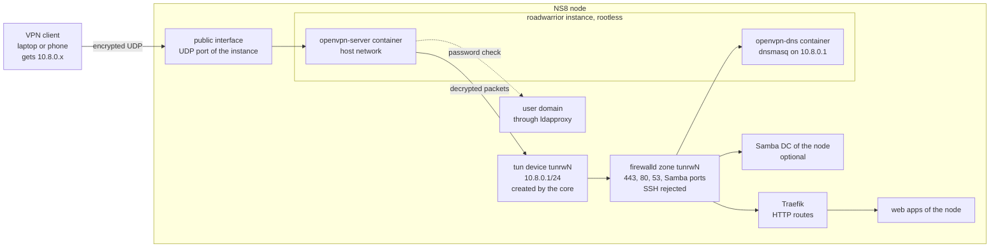
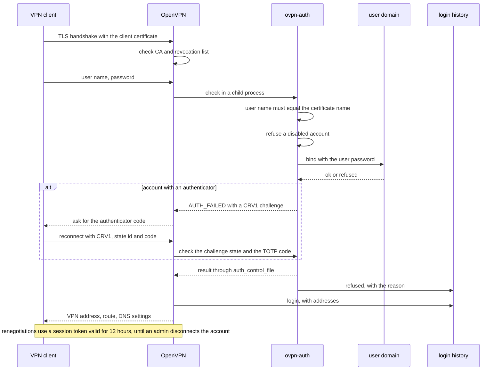
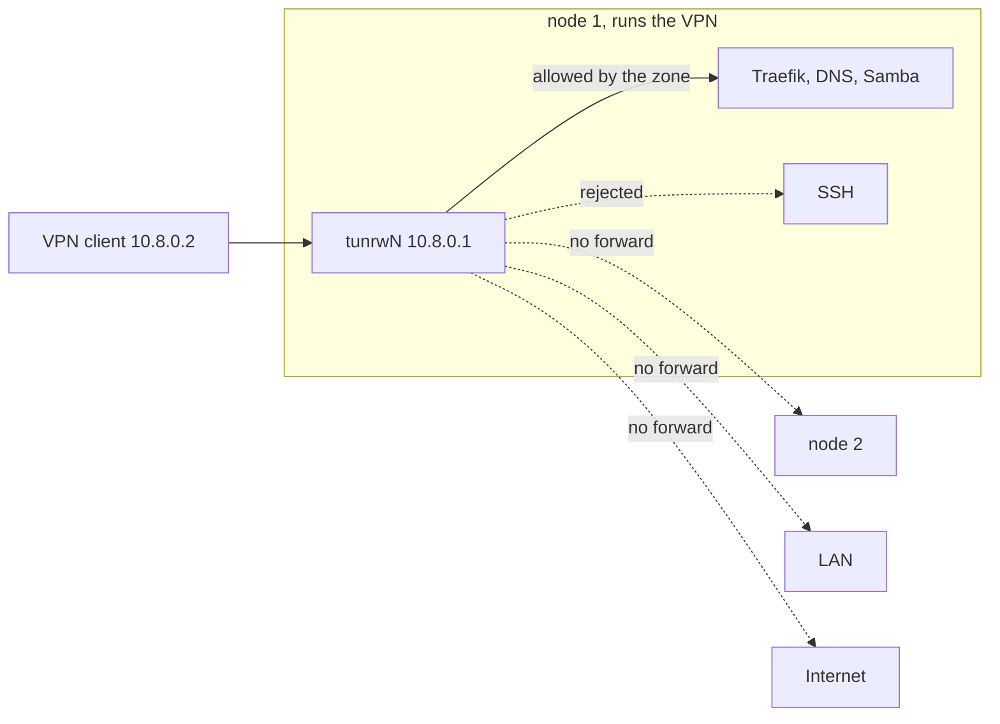
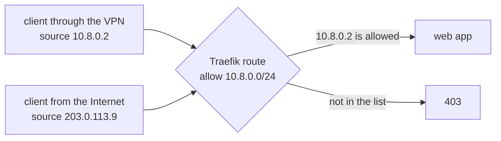
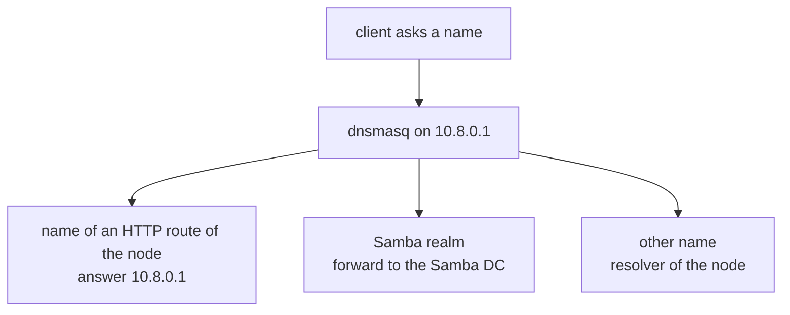
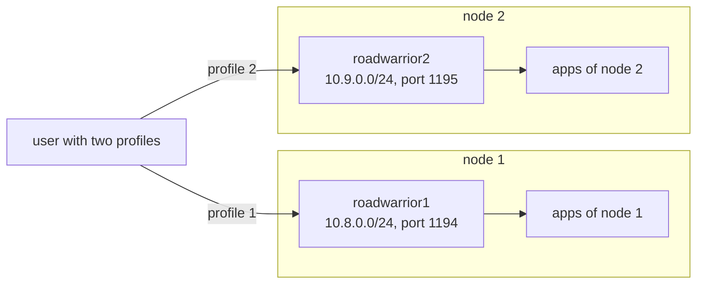

# How the network works

This page explains the path of a VPN client, from the Internet to the web apps of the node. It also explains why a client reaches only the node it connects to.

## The pieces

The module runs rootless, so it cannot create network devices or firewall rules. It asks the core instead:

- `add_tun` creates the tun device with the server address, for example `10.8.0.1/24`.
- `add_custom_zone` puts the tun in its own firewalld zone. That zone opens only the ports the clients need.
- `add_public_service` opens the UDP port of the instance on the public side.

OpenVPN runs with the host network and receives the tun from the core. It does not configure addresses or routes itself (`ifconfig-noexec`, `route-noexec`). Without a container network in the middle, throughput stays close to the line rate.

## A login

In certificate mode the password and code steps are skipped: the certificate alone gives access.

The challenge state lives 3 minutes and works once.

## Where the packets can go

The node does not forward packets from the tun zone. So a client reaches the services of this node only. The default route of the client stays on its own network: its Internet traffic does not enter the VPN.

Reaching other nodes, the LAN or Internet through the VPN needs a firewalld policy with forward and masquerade. A rootless module cannot create it. It waits for a core action, planned for a later version.

## Keeping an app for the VPN clients

Traefik runs on the host network too, so it sees the real VPN address of the client, for example `10.8.0.2`. An HTTP route with "Allow access from" set to the VPN network then accepts the VPN clients only.

The client must reach the app through the VPN for this to work. That is the job of the DNS below.

## DNS

The names of the HTTP routes and the FQDN of the node resolve to the VPN address of the node. Their traffic enters the VPN and Traefik sees `10.8.0.x`. Without the VPN resolver, the same name gives the public address: the traffic goes around the tunnel and an app kept for the VPN answers 403.

The server pushes the resolver three ways, so each client finds one it knows:

- `dhcp-option DNS 10.8.0.1`, for every client;
- `dhcp-option DOMAIN <domain>`, so NetworkManager and Windows send those domains to the VPN resolver;
- `dns server 0 address` and `resolve-domains`, the split DNS of OpenVPN 2.6 clients;
- `dns search-domains`: an OpenVPN 2.7 client drops the `dhcp-option DOMAIN` lines when it gets `dns` options, and rebuilds them from this list for NetworkManager.

The domains are the parent domains of the route names and of the node FQDN, plus the Samba realm when the file server is open. When the VPN host shares one of these domains, the full host names are pushed instead of the domain.

The host of the VPN server is left out on purpose. A client that keeps the VPN resolver during a reconnect would otherwise look for the server inside the tunnel.

When an HTTP route is added or removed, the `hosts-changed` event rewrites the dnsmasq list.

## Windows clients in the domain

With `expose_samba` on, the VPN opens the ports of the domain controller, NTP included, and the realm resolves through the tunnel.

- A computer already joined to the domain opens the session with its cached credentials, then the user connects the VPN. Kerberos, the shares and the group policies work from there, the policies at their next refresh.
- A network logon before the session, for a new user or an expired password, needs the VPN up before Windows asks for the password. Only the `certificate` mode allows it, with the profile started by the OpenVPN service: the password and TOTP checks are lost.
- Joining a computer to the domain through the VPN is not tested.

## Use the VPN

The profile holds no DNS setting: the server pushes it at each connection. What the client does with it depends on the client.

- NetworkManager, OpenVPN Connect, OpenVPN GUI on Windows and Tunnelblick apply it on their own.
- The `openvpn` command on Linux does not change the resolver by itself. Run it with the systemd-resolved helper of your distribution, for example:

      openvpn --config alice@vpn.example.org.ovpn --script-security 2 \
        --up /etc/openvpn/update-systemd-resolved --down /etc/openvpn/update-systemd-resolved --down-pre

Check from the client, once connected, with `app.example.org` an HTTP route of the node:

1. The name gives the VPN address of the node.

       resolvectl query app.example.org      # Linux with systemd-resolved
       nslookup app.example.org              # Windows, macOS

   Expect `10.8.0.1`. A public address means the client does not use the VPN resolver.

2. The packets go through the tunnel.

       ip route get 10.8.0.1                 # Linux: dev tun0
       route print                           # Windows: 10.8.0.0 on the VPN adapter

3. Traefik sees the VPN address. Open the app: with "Allow access from" set to the VPN network it answers, without the VPN it answers 403.

If the name still gives the public address, flush the DNS cache of the client (`resolvectl flush-caches`, `ipconfig /flushdns`) and check that the browser does not use its own DNS over HTTPS.

## Several nodes

Each node that runs apps for the VPN clients needs its own instance, with its own network and port. A user gets one profile per node.

## Clone and move

A clone or a move copies the PKI, the accounts, the authenticator secrets and the history. The new instance creates its own tun, zone and port on the target node. The profiles keep the old host. They work again once the host name points to the new node, or after a new download if the host was an IP address. While the original instance still runs on the same node, the copy cannot take the same port and network, and it stays stopped until the original is removed.
